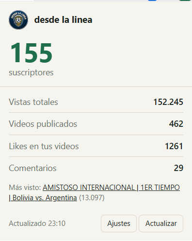

# YouTube Channel Stats


Extensión de Chrome que muestra en un vistazo las estadísticas de tu canal de YouTube (suscriptores, vistas, videos, likes y comentarios), pone tus suscriptores en el icono de la barra y te avisa con una notificación cuando cambian.



## Por qué existe

Revisar YouTube Studio varias veces al día es lento y distrae. Quería ver el número que me importa sin abrir una pestaña, y enterarme en el momento en que llega un suscriptor nuevo.

## Qué hace

- Suscriptores, vistas totales, videos publicados, likes y comentarios de tu canal.
- Número de suscriptores en el icono de la extensión (badge).
- Notificaciones cuando suben o bajan los suscriptores o se detecta un video nuevo.
- Revisión automática en segundo plano, con intervalo configurable (mínimo 5 minutos).
- Muestra tu video más visto.
- Modo claro y oscuro automático.

## Cómo funciona

- **Manifest V3** con un service worker (`background.js`) que usa `chrome.alarms` para revisar el canal periódicamente.
- `api.js` resuelve el canal por `@usuario`, URL o ID, recorre la lista de subidas con `playlistItems` (hasta 200 videos) y consulta las estadísticas por lotes de 50 con `videos.list`.
- Compara la lectura nueva con la anterior guardada en `chrome.storage.local` y lanza `chrome.notifications` si hay cambios.
- Los ajustes (canal, clave de API, intervalo) se guardan en `chrome.storage.sync`.
- El popup escapa todo el contenido recibido de la API antes de pintarlo.

## Instalación

1. Clona o descarga este repositorio.
2. Consigue una clave de API gratuita:
   1. Entra a [Google Cloud Console](https://console.cloud.google.com) y crea un proyecto.
   2. En **APIs y servicios > Biblioteca** habilita **YouTube Data API v3**.
   3. En **Credenciales > Crear credenciales > Clave de API**, restringe la clave a YouTube Data API v3 y déjala sin restricción de aplicación.
3. En `chrome://extensions` activa el **Modo desarrollador** y pulsa **Cargar descomprimida** eligiendo la carpeta que contiene `manifest.json`.
4. Abre los ajustes de la extensión, pega tu `@usuario` y tu clave, y guarda.

## Privacidad

No hay servidores intermedios ni analítica. La clave y los datos se quedan en tu navegador y las únicas peticiones van a `googleapis.com`. Más detalle en [PRIVACY.md](PRIVACY.md).

## Límites conocidos

- Los likes se suman sobre los últimos 200 videos, porque la API no ofrece un total del canal.
- Si el canal oculta sus suscriptores, la API no entrega ese número.
- La API pública redondea los suscriptores a tres cifras significativas a partir de 1.000.

## Ideas para siguientes versiones

- Historial y gráfica de crecimiento.
- Alertas por metas (1.000, 5.000, 10.000 suscriptores).
- Comparar varios canales.
- Login con OAuth para ver analíticas privadas.

## Estructura

```
manifest.json     configuración de la extensión (MV3)
background.js     service worker: alarmas, badge y notificaciones
api.js            cliente de YouTube Data API v3
popup.html/js     interfaz del popup
options.html/js   pantalla de ajustes
icons/            iconos 16, 48 y 128 px
```

## Licencia

MIT. Ver [LICENSE](LICENSE).
